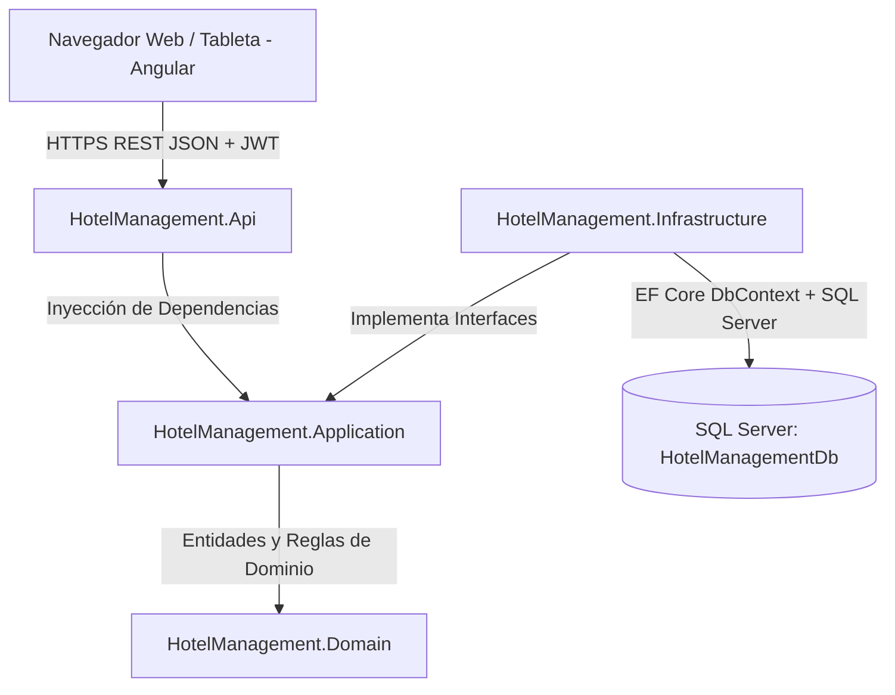

# DOCUMENTO DE ARQUITECTURA DEL SISTEMA
## Sistema de Gestión Hotelera Integral Multitenant (PMS)

---

## 1. Visión General de la Arquitectura
El sistema adopta **Clean Architecture (Onion Architecture)** en el backend (.NET 9 C#) y una **Arquitectura Modular Orientada a Componentes y Servicios** en el frontend (Angular 19/20 con TypeScript y Standalone Components).
La persistencia de datos utiliza **Microsoft SQL Server 2025** a través de Entity Framework Core.

---

## 2. Organización del Backend (Clean Architecture)

### 2.1. HotelManagement.Domain
- Núcleo puro sin dependencias de frameworks externos (no depende de EF Core, ni ASP.NET, ni librerías de terceros).
- **Entidades de Dominio:** `Hotel`, `Room`, `RoomType`, `Season`, `Promotion`, `HotelTax`, `CancellationPolicy`, `AdditionalService`, `Guest`, `DataConsent`, `Reservation`, `ReservationCompanion`, `ReservationStateHistory`, `Folio`, `FolioCharge`, `FolioPayment`, `CashShift`, `User`, `HotelUser`, `AuditLog`, `IdempotencyKey`.
- **Value Objects:** `Money`, `DateRange`, `AuditMetadata`.
- **Enums de Estado:**
  - `ReservationStatus`: `Pendiente`, `Confirmada`, `CheckIn`, `CheckOut`, `Liquidada`, `Anulada`, `NoShow`.
  - `RoomOperationalStatus`: `Disponible`, `Ocupada`, `FueraDeServicio`, `Mantenimiento`.
  - `RoomCleaningStatus`: `Limpia`, `Sucia`, `EnLimpieza`, `EnRevision`.
  - `PaymentMethod`: `Efectivo`, `TarjetaDebito`, `TarjetaCredito`, `Transferencia`.
  - `FolioStatus`: `Abierto`, `Cerrado`.
  - `ShiftStatus`: `Abierto`, `Cerrado`.
  - `AuditLevel`: `Negocio`, `Tecnico`, `Http`.
- **Excepciones de Dominio:** `DomainException`, `OverbookingException`, `InvalidStateTransitionException`, `FolioBalanceNonZeroException`, `TenantAccessViolationException`.

### 2.2. HotelManagement.Application
- Orquesta los casos de uso, lógica de aplicación, validaciones y contratos DTO.
- **Interfaces de Servicios y Repositorios:** `IHotelDbContext`, `ITenantContext`, `ICurrentUserService`, `IPasswordHasher`, `ITokenService`, `IEmailService`, `IQrCodeService`, `IPdfReportService`, `IExcelReportService`, `IDateTimeProvider`.
- **DTOs Específicos:** Mapeo explícito (evitando sobre-exposición de entidades de dominio).
- **Motores de Cálculo:**
  - `PricingEngine`: Cálculo desglosado de tarifas nocturnas, temporadas, recargos de fin de semana, promociones e impuestos.
  - `ReservationStateMachine`: Validación formal de transiciones permitidas y registro en historial.
  - `FolioCalculator`: Totalizador de cargos, impuestos, contra-asientos, abonos y saldo neto.
  - `KpiCalculator`: Cálculo de métricas hoteleras (Ocupación %, ADR, RevPAR, Ingresos, Cancelaciones).

### 2.3. HotelManagement.Infrastructure
- Implementa el acceso a datos, servicios externos y tecnología específica.
- **Entity Framework Core:** `HotelDbContext` configurado para SQL Server.
- **Multitenancy Global Query Filter:**
  - `builder.Entity<T>().HasQueryFilter(e => e.HotelId == _tenantContext.CurrentHotelId || _tenantContext.IsGlobalBypass)`
  - Se aplica en `Room`, `Reservation`, `Guest`, `Folio`, `CashShift`, `AdditionalService`.
- **Interceptores de EF Core:**
  - `AuditSaveChangesInterceptor`: Captura cambios técnicos (Entidad, valores antiguos JSON, valores nuevos JSON, usuario, estampa de tiempo UTC) y persiste en `AuditLogs`.
- **Servicios Concretos:**
  - `JwtTokenService`: Emisión de JWT (15 min) y Refresh Token rotativo con detección de replay.
  - `BCryptPasswordHasher`: Hashing seguro de contraseñas.
  - `EmailNotificationService`: Emisión asíncrona desacoplada con cola de reintentos.
  - `PdfReportService`: Generación de comprobantes, vouchers QR y reportes en PDF.
  - `ExcelReportService`: Generación de reportes de transacciones y huéspedes en OpenXML.

### 2.4. HotelManagement.Api
- Controladores RESTful con contratos HTTP coherentes.
- **Middlewares Globales:**
  - `ExceptionHandlingMiddleware`: Traduce excepciones de dominio a códigos HTTP estándar (400, 403, 404, 409, 422, 500) en formato RFC 7807 (ProblemDetails).
  - `CorrelationIdMiddleware`: Inyecta y propaga `X-Correlation-Id`.
  - `TenantResolutionMiddleware`: Extrae el `HotelId` del claim del token JWT o del encabezado `X-Hotel-Id` (validando autorización).
  - `HttpAuditMiddleware`: Registra solicitudes sensibles y consultas inter-sedes en la tabla `AuditLogs` con nivel `Http`.
- **Filtros:** `IdempotencyFilter` que intercepta peticiones con cabecera `Idempotency-Key`.

---

## 3. Estrategia de Multitenancy y Aislamiento por Sede

1. **Modelo de Aislamiento:** Base de datos compartida con esquema discriminado por columna `HotelId` (Shared Database, Separate Data).
2. **Doble Barrera de Seguridad:**
   - **Barrera 1 (Infraestructura / EF Core):** Global Query Filters aplicados automáticamente en todas las consultas para evitar fugas inadvertidas de datos.
   - **Barrera 2 (Capa de Aplicación / Autorización):** Los servicios validan explícitamente que la entidad consultada pertenezca a la sede activa. Si un usuario intenta acceder a un recurso de otra sede manipulando un ID, el sistema responde **HTTP 404 (Not Found)** conforme a RF-07, impidiendo inferir la existencia de recursos ajenos.
3. **Excepción Inter-Sedes Controlada (RF-20 / RF-21):**
   - El endpoint `/api/availability/cross-hotel` omite el filtro de tenant únicamente para proyectar un DTO resumen: `(HotelId, HotelName, RoomTypeName, AvailableCount, ReferenceRate)`.
   - Está prohibido proyectar números de habitación, nombres de huéspedes, reservas o información financiera de otras sedes.
   - Cada consulta inter-sedes queda registrada en `AuditLogs` con nivel `Http`.

---

## 4. Estrategia de Consistencia y Prevención de Overbooking (RF-24 / RNF-11)

1. **Definición Matemática de Traslape de Fechas:**
   Dos estancias `[In1, Out1)` e `[In2, Out2)` se traslapan si y solo si:
   $$\text{In1} < \text{Out2} \land \text{Out1} > \text{In2}$$
   *Nota:* Si una estancia sale el 2026-10-15 y otra entra el 2026-10-15, `Out1 == In2`, por lo que **no existe traslape**.
2. **Garantía en Base de Datos (SQL Server):**
   - Trigger atómico de integridad `TR_Reservations_PreventOverbooking` ejecutado en `INSERT` y `UPDATE`.
   - El trigger verifica que no existan reservas activas (`Status IN ('Pendiente', 'Confirmada', 'CheckIn')`) para la misma habitación que se solapen. Si se detecta solapamiento, se realiza un `ROLLBACK TRANSACTION` y se eleva un error SQL 50001.
3. **Control de Concurrencia en Aplicación (RF-25):**
   - Columna `RowVersion` (`rowversion` / `byte[]`) en entidades `Room` y `Reservation` para control de concurrencia optimista.
   - En peticiones simultáneas, EF Core detecta `DbUpdateConcurrencyException`, traduciéndose en **HTTP 409 Conflict**.
   - En transacciones de reserva, se utiliza nivel de aislamiento `IsolationLevel.Serializable` con reintento controlado o bloqueo de lectura.

---

## 5. Diseño del Frontend (Angular)

- **Tecnología:** Angular 19+ con Standalone Components, Reactive Forms y RxJS.
- **Diseño Visual:** Paleta corporativa sobria y moderna (Azul marino `#17365D`, azul claro `#D9EAF7`, acentos dorados `#C5A059`, fondo neutro `#F8FAFC`, tipografía Inter/Outfit).
- **Módulos y Vistas:**
  - `/login`: Inicio de sesión seguro con detección de bloqueos.
  - `/dashboard`: Panel gerencial con KPIs hoteleras (Ocupación, ADR, RevPAR, Ingresos, Cancelaciones) y gráficos interactivos.
  - `/availability`: Motor de cotización y disponibilidad por fechas y personas + consulta inter-sedes.
  - `/calendar`: Grilla visual de ocupación de 14 días con código de colores.
  - `/reservations`: Listado de reservas, asistente de creación con soporte de idempotencia, y detalle con máquina de estados.
  - `/reception`: Flujos de Check-in (validación de limpieza y consentimiento Habeas Data) y Check-out (validación saldo cero).
  - `/folio/:id`: Estado de cuenta del huésped, cargos de catálogo, contra-asientos de anulación auditados, pagos y descarga de comprobante PDF.
  - `/housekeeping`: Interfaz táctil responsive para tabletas y móviles para actualización de estado de limpieza por camareras.
  - `/cash-shift`: Gestión y cierre de caja por turno con congelamiento de totales.
  - `/admin/hotels`: Gestión de las 4 sedes e identidades corporativas.
  - `/admin/rooms`: Inventario de tipos y habitaciones físicas.
  - `/admin/pricing`: Parametrización de temporadas, promociones, recargos e impuestos.
  - `/admin/services`: Catálogo de consumos y servicios adicionales por hotel.
  - `/admin/users`: Empleados, roles y asignación multisede.
  - `/audit`: Visor de auditoría de negocio, técnico y HTTP con filtros y exportación.
- **Interceptores:**
  - `JwtInterceptor`: Inyecta el Bearer Token y el `X-Hotel-Id` activo.
  - `ErrorInterceptor`: Manejo centralizado de notificaciones Toast y redirección ante 401/403.
  - `IdempotencyInterceptor`: Genera automáticamente `Idempotency-Key` en operaciones de creación de reservas y pagos.
